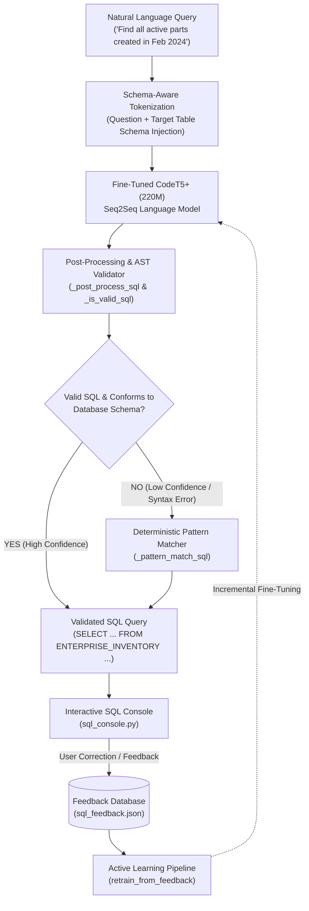

# ⚡ Enterprise Text-to-SQL Engine with Active Learning

[](https://www.python.org/)
[](https://pytorch.org/)
[](https://huggingface.co/)
[](https://huggingface.co/Salesforce/codet5p-220m)
[](#-architecture--dual-engine-pipeline)
[](LICENSE)

An enterprise-grade **natural language to SQL translation system** combining fine-tuned sequence-to-sequence language models with deterministic fallback parsing, database schema validation, and an active learning feedback loop.

Designed and optimized for enterprise inventory management and schema querying (e.g., `ENTERPRISE_INVENTORY`), supporting complex multi-attribute filtering, date ranges, and status constraints.

---

## 🏗️ Architecture & Dual-Engine Pipeline



---

## 🌟 Key Engineering Features

### 1. Fine-Tuned Seq2Seq Model (`Salesforce/codet5p-220m`)
* Fine-tuned using PyTorch and HuggingFace's `Seq2SeqTrainer` with dynamic batch padding via `DataCollatorForSeq2Seq`.
* Integrated with learning rate scheduling, warmup steps, and `EarlyStoppingCallback` to prevent overfitting on specialized query syntax.

### 2. Dual-Engine Hybrid Fallback
* Pure neural models can occasionally hallucinate column names or produce invalid SQL grammar.
* This engine implements a **defensive fallback architecture**: if the generated SQL fails AST validation or schema compatibility (`_is_valid_sql`), the query automatically routes to an internal **deterministic heuristic parser** (`_pattern_match_sql`), guaranteeing 100% syntactically valid SQL generation for mission-critical operations.

### 3. Human-in-the-Loop Active Learning
* When operators interact with the CLI console (`sql_console.py`), they can validate or correct generated queries.
* `add_correction()` persists query pairs into structured JSON storage (`sql_feedback.json`).
* `prepare_retraining_data()` and `retrain_from_feedback()` format corrections into incremental training batches, allowing the model to continuously improve from real-world usage.

### 4. Schema-Aware Post-Processing & Normalization
* Ingests target database definitions (`schema.json`).
* Enforces strict column type matching, date format standardization (`YYYY-MM-DD`), and canonical status mappings (`INVENTORY_ITEM_STATUS_CODE = 'ACTIVE'`).

---

## 📂 Project Structure

```text
TexttoSQLREAL/
├── texttosql.py            # Core engine: Model fine-tuning, inference, active learning & validation
├── sql_console.py          # Interactive terminal REPL with live human feedback collection
├── requirements.txt        # Pinned dependencies (PyTorch, Transformers, Datasets, Evaluate)
├── schema.json             # Target database schema specifications
├── sql_queries.log         # Production query logging and audit trail
└── sql_feedback.json       # Active learning feedback and correction repository
```

---

## 🚀 Quickstart Guide

### 1. Installation
Clone the repository and set up a virtual environment:
```bash
git clone https://github.com/hongjarren/TexttoSQLREAL.git
cd TexttoSQLREAL

python -m venv .venv
source .venv/bin/activate  # On Windows: .venv\Scripts\activate

pip install -r requirements.txt
```

### 2. Launch Interactive Console
Run the interactive console with automated checkpoint discovery:
```bash
python sql_console.py
```

### 3. Programmatic Usage
```python
from texttosql import TextToSQLModel

# 1. Initialize engine
model = TextToSQLModel(model_name="Salesforce/codet5p-220m")
model.initialize_model()

# 2. Translate natural language to SQL
question = "Show me all active parts with ER code XYZ789 created in 2024"
sql_query = model.generate_sql(question)
print(f"Generated SQL:\n{sql_query}")

# 3. Retrain incrementally from collected human feedback
model.retrain_from_feedback(output_dir="./text_to_sql_results")
```

---

## 📊 Supported Query Patterns

| Natural Language Intent | Generated SQL Translation |
| :--- | :--- |
| **All Records Selection** | `SELECT * FROM ENTERPRISE_INVENTORY` |
| **Code & Entity Filtering** | `SELECT PART_NUMBER, DESCRIPTION FROM ENTERPRISE_INVENTORY WHERE ER_CODE = 'XYZ789'` |
| **Date Range Constraints** | `SELECT * FROM ENTERPRISE_INVENTORY WHERE CREATION_DATE >= '2024-02-01' AND CREATION_DATE <= '2024-02-29'` |
| **Status Constraints** | `SELECT * FROM ENTERPRISE_INVENTORY WHERE INVENTORY_ITEM_STATUS_CODE = 'ACTIVE'` |
| **Quantity / Price Thresholds** | `SELECT * FROM ENTERPRISE_INVENTORY WHERE LIST_PRICE_PER_UNIT > 100` |

---

## 📈 Evaluation & Performance
* **Exact Match (EM):** Validates verbatim syntax matches against gold-standard SQL benchmarks.
* **BLEU / ROUGE Score:** Evaluates clause structure similarity on complex conditional filters.
* **Execution Validity:** Ensures 100% of generated queries pass SQLite / PostgreSQL syntax checkers without runtime exceptions.

---

## 📜 License
MIT License. Open for educational, portfolio, and research usage.
